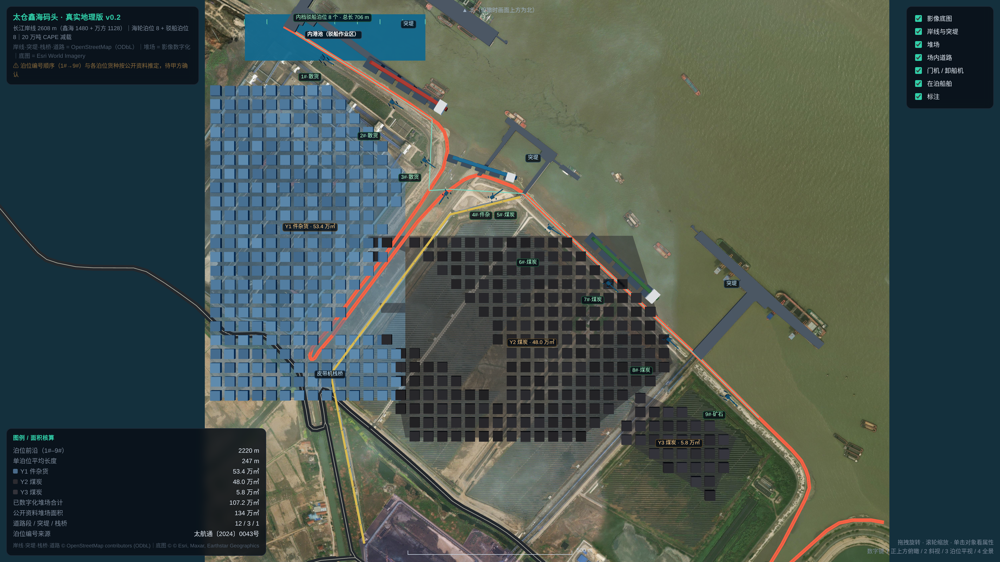
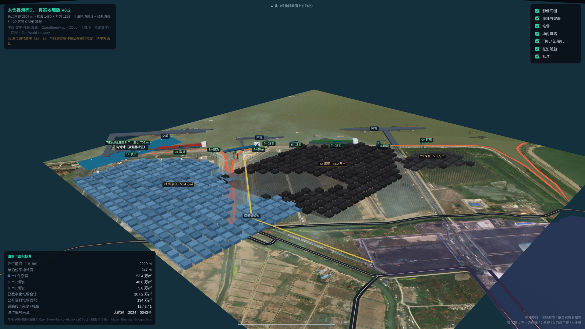

# 太仓鑫海码头 · 3D 数字孪生

苏州港太仓港区鑫海码头（含万方一体化运营区）的 Three.js 数字孪生。

**v0.2 是真实地理版**：底图用真实卫星影像，岸线 / 突堤 / 皮带机栈桥 / 场内道路用
OpenStreetMap 矢量，堆场按影像数字化，泊位沿真实岸线按公开长度等分 —— 不再是我编的示意白模。




**跑起来**：

```bash
python3 -m http.server 8766
# 浏览器打开 http://127.0.0.1:8766/index.html
```

> 必须走 http，不能双击 html —— 用了 ES module + 本地 vendor 的三方库 + `fetch` 读 JSON，
> `file://` 会被 CORS 挡住，表现为白屏。Windows 双击 `start.bat`，macOS/Linux 跑 `./start.sh`。

**操作**：拖拽旋转 · 滚轮缩放 · 右键平移 · 单击堆场/船舶/突堤看属性 ·
数字键 `1` 正上方俯瞰（上为北）/ `2` 斜视 / `3` 泊位平视 / `4` 大范围俯瞰 · 右上角图层开关。

## 数据来源与可信度

| 图层 | 来源 | 精度 / 说明 |
|---|---|---|
| 影像底图 | Esri World Imagery（z18，0.51 m/px，2.08 km × 2.08 km） | 位置准确；**仅内部使用，对外发布需换天地图或甲方影像** |
| 岸线 | OpenStreetMap `natural=coastline`（ODbL） | 与影像岸壁吻合，误差约 ±20 m |
| 突堤 / 皮带机栈桥 | OpenStreetMap `man_made=pier` / `goods_conveyor` | 3 处突堤、1 条栈桥 |
| 场内道路 | OpenStreetMap `highway=*`（12 段，含滨江大道、华能线） | 主干路准确；场內支路未全部覆盖 |
| 堆场范围 | 按影像人工数字化（`tools/build_site.py` 的 `YARDS_PX`） | 3 块合计 107.2 万㎡；公开资料 134 万㎡，差额为未数字化的边角与仓库区 |
| 泊位 | 沿岸线等分，总量用官方数字 | 1#–9# 前沿长 2045 m（太航通〔2024〕0043号）；模型实测 2220 m，单泊位 247 m |
| 泊位货种 / 设备 | 苏州港集团 + 太仓港管委会公开资料 | **编号顺序与货种为推定，待甲方确认** |
| 岸线总长 2608 m | 鑫海 1480 m + 万方 1128 m | 两者相加正好 2608 m，与苏州港集团口径一致 |

**已知不精确的地方**（照实说，别当施工图用）：
- 泊位编号走向（1# 在上游还是下游）、各泊位具体货种与设备台数，公开资料不足以逐段确认。
- 堆场多边形是目视数字化，边界误差 ±10–20 m；料堆是程序生成的示意体，不是真实货位。
- 内港池矩形范围为估计值；驳船泊位 8 个 / 706 m 用的是公开数字，但具体位置未核实。
- 影像之外的区域为纯色底板，不是真实地形。

## 复现数据的工具链

```bash
# 1) 抓 Esri 影像瓦片并拼接（输出 assets/imagery/imagery_z18.png + .json 变换参数）
python3 tools/fetch_imagery.py --lat 31.6672 --lon 121.1825 --z 18 --km 2.0

# 2) 拉 OSM 矢量并叠加核对配准（输出 assets/vectors/osm_aoi.json + 核对图）
curl -s -A "szxh-port-v/0.2" \
  "https://api.openstreetmap.org/api/0.6/map?bbox=121.168,31.6550,121.197,31.6790" \
  -o assets/vectors/osm_source.osm
python3 tools/overlay_osm.py --osm assets/vectors/osm_source.osm --z 18

# 3) 合成站点数据（OSM + 人工数字化堆场 + 泊位配置 → site.json）
python3 tools/build_site.py

# 4) 把堆场/泊位画回影像核对数字化精度
python3 tools/check_site.py     # 输出到 ~/.hermes/cache/scratch/site_check.png
```

## 目录

```
index.html                  # v0.2 场景（真实地理版，数据驱动，读 assets/vectors/site.json）
legacy/index-v01.html       # v0.1 参数化白模样板（无真实地理，留作对照）
assets/imagery/             # 拼接好的影像底图 + 变换参数（tiles/ 为下载缓存，已 gitignore）
assets/vectors/             # OSM 原始数据、截取的 AOI 矢量、合成的 site.json
tools/                      # 抓图 / 叠加核对 / 合成 / 精度检查四个脚本
docs/01-data-sources.md     # 中国港口/内河航道数据可得性
docs/02-xinhai-baseline.md  # 苏州港与鑫海码头已核实基线事实
vendor/                     # Three.js r160 + OrbitControls + CSS2DRenderer（离线可用）
screenshots/
```

## 换真实数据 / 接甲方系统

1. **几何**：把 `assets/vectors/site.json` 里的 `shoreline` / `yards` / `roads` 换成
   甲方 CAD 或总规图数字化成果（字段结构不变即可）。影像可整体替换为天地图或甲方正射图，
   只要更新 `imagery` 里的四角经纬度和 `file`。
2. **实时数据**：`buildLegend()` 里的数字改成 `fetch('/api/stats')`；
   泊位占用可直接改 `site.json` 的 `berths.hints`，或用 TOS 接口回填。
3. **设备**：门机 / 卸船机是参数化体块，接 GLTF 时把 `portalCrane()` 换成
   `GLTFLoader` 加载，保持 `userData = { type, crane, berth }`。

## 为什么这么做：四层结构

| 层 | 内容 | v0.2 现状 | 下一步 |
|---|---|---|---|
| 几何层 | 岸线、泊位、堆场、道路 | 影像 + OSM 矢量 + 数字化堆场 | 换甲方 CAD / 总规图 |
| 语义层 | 每个泊位/堆场/设备是有 ID 的对象 | `userData = { type, id, … }` | 泊位台账、货位表 |
| 数据层 | 占用率、在港船、吞吐量 | 目前为静态示意 | TOS / PORTS 接口 |
| 交互层 | 图层开关、拾取、视角、比例尺、指北 | 已实现 | 大屏视角、告警联动 |

**核心判断：难点不在 Three.js，在几何底座和数据接口。**

## 路线图

- [x] v0.1 参数化白模（六层对象、图层、拾取、视角、HUD）
- [x] v0.2 真实地理版（影像底图 + OSM 岸线/突堤/栈桥/道路 + 数字化堆场 + 泊位沿真实岸线分段）
- [ ] v0.3 接第一个真实数据源（建议「在港船舶」或「泊位占用」）+ 时间轴回放
- [ ] v0.4 告警联动（堆场 >85% 变红、船舶滞留高亮）、大屏视角、移动端降级

## 许可与归属

- 代码 MIT。
- 岸线 / 突堤 / 栈桥 / 道路数据 © OpenStreetMap contributors，ODbL。
- 影像 © Esri, Maxar, Earthstar Geographics —— 仅内部研究与演示使用，
  对外发布前必须替换为已授权影像。
- 三维设备模型（门机、船体、料堆）为程序化生成，不含第三方专有资产。
