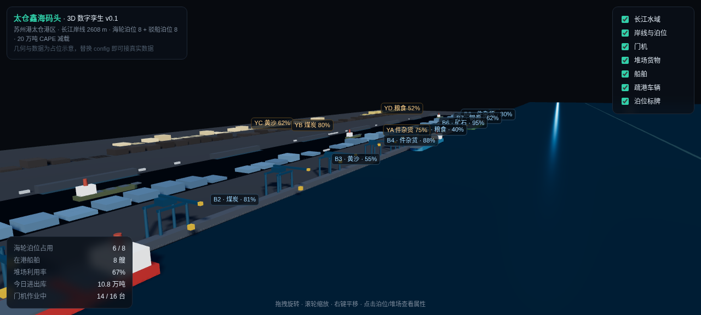

# 太仓鑫海码头 · 3D 数字孪生

苏州港太仓港区鑫海码头的 Three.js 数字孪生原型。开箱即可看到
「岸线 — 泊位 — 门机 — 堆场 — 船舶 — 疏港车辆」六层对象，
几何由 `CFG` 参数驱动，换掉 config 就是换一个码头。

**跑起来**：

```bash
python3 -m http.server 8765
# 浏览器打开 http://127.0.0.1:8765/index.html
```

> 必须走 http，不能双击 html —— 本地用了 ES module + vendor 的三方库，
> `file://` 会被 CORS 挡住，表现为白屏。

Windows 双击 `start.bat`，macOS/Linux 运行 `./start.sh`。



**操作**：拖拽旋转 · 滚轮缩放 · 右键平移 · 单击泊位/堆场/船舶看属性 ·
数字键 `1` 全景 / `2` 泊位平视 / `3` 俯视总图 · 右上角图层开关。

## 目录

```
index.html                # 全部场景逻辑，单文件，无构建步骤
vendor/                   # Three.js r160 + OrbitControls + CSS2DRenderer（已本地化，离线可用）
start.sh / start.bat      # 本地静态服务器一键启动
screenshots/              # 交付截图
docs/01-data-sources.md   # 中国港口/内河航道数据可得性调研（哪些免费、哪些拿不到）
docs/02-xinhai-baseline.md # 苏州港与鑫海码头已核实的基线事实与数据断点
```

## 为什么长这样：四层结构

| 层 | 内容 | 当前实现 | 换真实数据需要什么 |
|---|---|---|---|
| 几何层 | 岸线、泊位、堆场、道路 | 按公开参数参数化挤出 | 港口总规图 + 天地图影像配准（0.5 m），或甲方 CAD |
| 语义层 | 每个泊位/堆场/设备是有 ID 的对象 | `userData = { type, id, … }` | 泊位编号表、堆场货位表、设备台账 |
| 数据层 | 占用率、在港船、吞吐量 | 伪造占位值 | TOS / PORTS 接口，或船闸过闸量 + 港区吞吐月度 |
| 交互层 | 图层开关、拾取、视角预设、HUD | 已实现 | 值班室大屏视角、告警联动 |

**核心判断：这个项目的难点不在 Three.js，在几何底座和数据接口。**
90% 的孪生场景用「挤出 + 贴图 + 参数化设备」就够，不要一上来上 BIM。

## 换真实数据：三处入口

1. `CFG.berthPlan`（index.html 顶部 `=== 配置层 ===`）—— 泊位编号、长度、货种、
   设计靠泊船型、占用率。真实值来自《苏州港总体规划（2024–2035）》靠泊能力表
   与港口经营许可。
2. 堆场数组 `yards` —— 每块堆场的 id、范围、货种；真实货位可从 TOS 导出。
3. `refreshHUD()` —— HUD 数字，改成 `fetch('/api/stats')` 轮询即可。

## 性能预算（v0.1 实测）

- draw call ≈ 60（堆场用 `InstancedMesh`，一块堆场一次调用；70 辆疏港车一次调用）
- 目标 1080p / 60 fps，旧机器可跑；再上量继续走 InstancedMesh + LOD
- 阴影只给主要对象开，水面顶点动画限定在 90×42 网格

## 路线图

- [x] v0.1 参数化白模 + 六层对象 + 图层/拾取/视角/HUD
- [ ] 阶段 2（1–2 周）：天地图影像贴地 + 岸线矢量配准，门机换 GLTF
- [ ] 阶段 3（2–3 周）：接第一个真实数据源跑通闭环（建议先「在港船舶」或「泊位占用」），
      加时间轴回放
- [ ] 阶段 4（2 周）：告警联动（堆场 >85% 变红、船舶滞留高亮）、大屏视角、移动端降级

## 数据真实性声明

**几何**：2608 m 岸线、8 个海轮泊位 + 8 个驳船泊位、224 万㎡ 占地、134 万㎡ 堆场
均为公开参数推出的示意体，**不代表真实平面布局**（真实线性由总规图和影像决定）。

**数据**：全部为伪造占位值，仅用于演示交互与视觉语言，任何数字都不得引用。

已核实的公开事实见 `docs/02-xinhai-baseline.md`，可得性边界见 `docs/01-data-sources.md`。

## 已知限制

- 未做移动端触控优化与 WebGL1 回退
- 未接入真实坐标系统（当前为本地坐标系，原点在码头中心）
- 上下游长江水域是按视觉需要延展的，不是真实河势

## 许可

代码 MIT。场景中不包含任何第三方专有几何资产。
